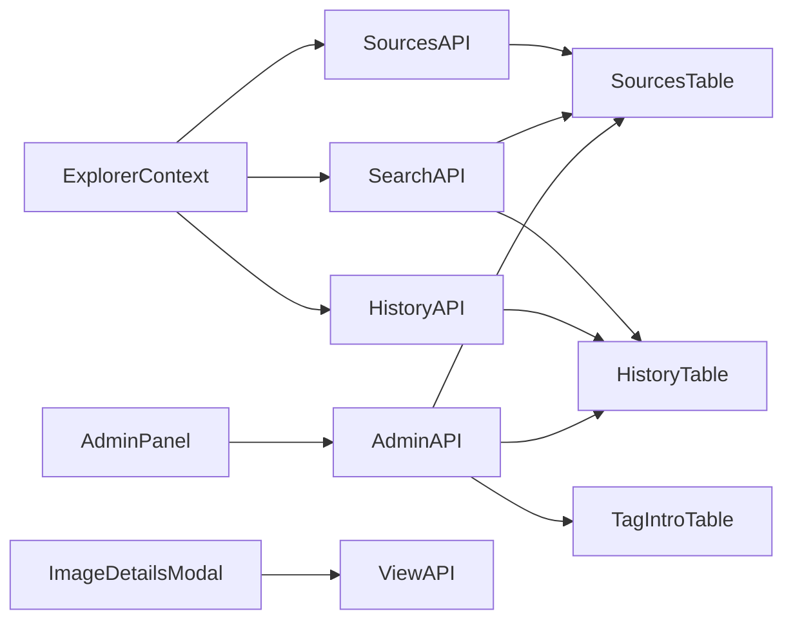

# Search Images Architecture

This document is the implementation contract for the NASA image explorer on branch `feat/search-images`. It is saved to [plans/search-images-architecture.md](plans/search-images-architecture.md) before any application code changes. Local development still runs through `docker compose -f docker-compose.dev.yml` (frontend `http://localhost:3001`, API `http://localhost:5001`, Postgres `localhost:5433`). A fresh machine reaches that state with one command, `./scripts/setup.sh`, specified in section 6.

The special feature is a Dynamic Classification and Semantic Tag Filtering System. It stores structured NASA metadata, centers, capture dates, keyword arrays, and object tags that occur literally in the seed text, then uses those fields for multi-select gallery filters and cross-field search.

The seed corpus is [backend/data/mock_data.json](backend/data/mock_data.json): 100 images, centers KSC (39), JSC (28), HQ (11), JPL (9), MSFC (4), ARC (3), GRC (2), GSFC (2), MAF (1), LRC (1), capture dates 1950-08-15 through 2024-09-04. Every item has `center`, `date_created`, `description`, `title`, `nasa_id`, and `media_type`. Keywords exist on 56 items. `location` exists on 50, `photographer` on 38, `album` on 13, `description_508` on 12, `secondary_creator` on 9. The current app drops all of that except title, media type, date string, description, and one image URL. See [backend/scripts/seed_db.py](backend/scripts/seed_db.py) and [backend/db/models.py](backend/db/models.py).

Object tags come from two deterministic, non-ML sources that are merged into `object_tags`:

1. **Literal text extraction.** Phrases from the frozen lexicon that occur as whole words in title, description, `description_508`, or keywords. Confirmed text phrases include `astronaut`, `rover`, `spacesuit`, `capsule`, `parachute`, `robotic arm`, `launch pad`, `soyuz`, and `orion`.
2. **Curated visual annotations.** A sidecar file [backend/data/visual_annotations.json](backend/data/visual_annotations.json) keyed by `nasa_id` stores human-verified, image-visible labels that never appear in the caption text (clothing, people, colors). These are allow-listed into the same lexicon and written onto `object_tags` at seed and ingest time. They are not model guesses.

**Canonical search expectation.** Query `men with blue shirt` (or `man with blue shirt`) must return every curated blue-shirt photograph in the seed set, including at least:

- **NASA Astronaut Victor Glover Views Artemis II Rocket Stage at NASA Michoud** (`nasa_id` `MAF_071424_Victor Glover Visits Pegasus-BH-7`)
- **Artemis I Baton Handoff from EGS Ops to Launch Director** (`nasa_id` `KSC-20220815-PH-KLS01_0016_`)
- **Expedition 6 Press Conference** (`nasa_id` `20030506_exp6pconf_01`)
- **KSC-07pd1929** (`nasa_id` `KSC-07pd1929`)
- **KSC-2010-1278** (`nasa_id` `KSC-2010-1278`)

These rows carry curated visual tags such as `man`, `men`, `blue shirt`, and `shirt` because those details are visible in the photographs even when the captions never say “blue shirt.” Query `smile` / `smiling` returns curated smiling portraits (for example Expedition 6 Press Conference and KSC-2010-1278). Appearance tags (`man`/`woman`/`smile`/`blue shirt`/…) are **visual-only**: they are never inferred from caption text, which is why filtering `women` must **not** return `KSC-07pd3126` (a helicopter rescue silhouette whose caption merely mentions a women-in-aerospace forum). Simple plural/synonym expansion in the scorer (`men`↔`man`, `shirts`↔`shirt`, `smile`↔`smiling`) activates the matching pills. A query such as `man with green shirt` still returns empty until a curated green-shirt annotation exists for some image.

## 1. Architectural and DB Design

Keep the table name `sources`. The public resource is already `/api/sources`. Add columns with SQLAlchemy 2 async models and PostgreSQL `TEXT[]` arrays. Arrays are the right store for flat tag sets because containment (`@>`) and overlap (`&&`) use GIN indexes. JSONB is reserved for history payloads, where each saved search has a nested result list.

`SourceModel` columns after the change:

- Existing, retained: `id` integer PK, `name` (NASA title), `type` (media type), `launch_date` (original ISO string), `description`, `image_url` (medium rendition used by cards), `status` default `Active`.
- Identity and NASA metadata: `nasa_id` `String(120)` unique, `center` `String(20)`, `location` text nullable, `photographer` text nullable, `secondary_creator` text nullable, `description_508` text nullable, `album` `ARRAY(Text)` default empty.
- Dates and usage: `creation_date` `DateTime(timezone=True)` parsed from `date_created`, `indexed_at` `DateTime(timezone=True)` set on first insert and never overwritten, `view_count` integer default 0, not null.
- Classification: `keywords` `ARRAY(Text)` default empty, `object_tags` `ARRAY(Text)` default empty.
- Assets: `image_full_url` text nullable, the `rel=canonical` original, falling back to the largest rendition.

`SearchHistoryModel` table `search_history`:

- `id` integer PK.
- `query` text, not null. Empty string means a filter-only browse is not stored; only explicit searches are stored.
- `filters` JSONB, not null. Shape: `centers`, `keywords`, `object_tags`, `date_from`, `date_to`, `sort`.
- `activated_object_tags` `ARRAY(Text)`, the pills the query turned on.
- `results` JSONB, not null. Each entry: `source_id`, `name`, `image_url`, `center`, `creation_date`, `confidence`, `matched_object_tags`, `matched_keywords`, `matched_terms`. Cap 100 rows, which covers this corpus.
- `result_count` integer, not null. This is the full match count, including rows past the stored cap.
- `created_at` `DateTime(timezone=True)` server default `now()`, not null.

`ObjectTagIntroductionModel` table `object_tag_introductions` is derived and refreshed by the seed script:

- `tag` text PK.
- `source_id` FK to `sources.id`, the earliest image that carries the tag. Tie-break by lowest `id`.
- `capture_date` timestamptz, that image's `creation_date`.
- `indexed_at` timestamptz, that image's `indexed_at`.

Indexes, declared on the models with SQLAlchemy `Index`:

- GIN `ix_sources_keywords_gin` on `sources.keywords`.
- GIN `ix_sources_object_tags_gin` on `sources.object_tags`.
- GIN `ix_sources_album_gin` on `sources.album`.
- B-tree `ix_sources_center` on `sources.center`.
- B-tree `ix_sources_creation_date` on `sources.creation_date`.
- B-tree `ix_sources_view_count` on `sources.view_count`.
- Unique B-tree `ix_sources_nasa_id` on `sources.nasa_id`.
- Composite `ix_history_created_id` on `search_history (created_at DESC, id DESC)` for history pagination.
- B-tree `ix_tag_intro_capture` on `object_tag_introductions.capture_date`.

`create_all` does not alter the volume that is already running. [backend/scripts/seed_db.py](backend/scripts/seed_db.py) today calls `drop_all`, which would erase `view_count` and history on every backend start. Replace that with additive startup:

- `create_all` for new tables.
- `ALTER TABLE sources ADD COLUMN IF NOT EXISTS ...` for every new column, with defaults so existing rows stay valid.
- Create the indexes with `CREATE INDEX IF NOT EXISTS`.
- Upsert the 100 sources by the existing sequential `id` (1..100). Update descriptive columns. Leave `view_count` and `indexed_at` unchanged when the row already exists. Set `view_count = 0` and `indexed_at = now()` only on insert.
- Recompute `object_tag_introductions` from current tags. Leave `search_history` untouched.

Keyword normalization: split each NASA keyword string on commas, trim, lowercase, drop tokens shorter than 2 characters, store the unique list. The raw NASA keyword strings are also kept in the API as `keywords_raw` so the modal can show the original catalog wording. Filtering and search use the normalized `keywords` array.

Object-tag extraction, implemented in `backend/services/tag_extractor.py` and frozen in `backend/data/object_lexicon.json`:

- The lexicon is a sorted list of phrases that already occur in this corpus and name a physical object, vehicle, instrument, celestial body, facility part, or role (`astronaut`, `rover`, `spacesuit`, `launch pad`, `robotic arm`, `capsule`, `parachute`, `soyuz`, `orion`, `crater`, and the other confirmed phrases). A phrase is added only after a whole-word scan of the seed file shows a count of at least 1.
- Matching is case-insensitive, longest phrase first, left to right. A shorter phrase inside an already consumed span is not recorded. A later separate occurrence of the shorter phrase still is. `robotic arm` therefore does not also emit `arm` from that same span. `space station` consumes `station` in that span.
- Tags are stored unique and sorted on the row.
- Re-running extraction is deterministic. The lexicon file is the allow-list; the extractor cannot invent a tag that is absent from it.

Confidence score, implemented in `backend/services/search_score.py`. It is a simulated score, as the assignment allows, with fixed weights for object tags, keywords, and description proximity. Range is 0 to 100, rounded to one decimal. Rows at 0 are omitted.

Definitions for one image and one query:

- Normalize the query to lowercase.
- `P` is the set of lexicon phrases found in the raw query, longest first. These are the activated object tags.
- `Q` is the remaining content tokens after removing stopwords `a an the of with and in on for to from by at or` and after removing tokens already covered by a phrase in `P`.
- `O` is `P` intersect the image's `object_tags` (exact membership).
- `K` is tokens from `P ∪ Q` that exactly equal one of the image's normalized keywords.
- `T` is tokens from `P ∪ Q` that occur as whole words in title or description.
- `object_score = |O| / |P|` when `P` is non-empty, else 0.
- `keyword_score = |K| / |P ∪ Q|` when the denominator is non-empty, else 0.
- `text_score = |T| / |P ∪ Q|` when the denominator is non-empty, else 0.
- `title_bonus = 0.05` when any query phrase or token occurs as a whole word in the title, else 0.
- `proximity_bonus = 0.05` when every matched text token or phrase occurs inside one 8-word window of the description, else 0.

Weights when the query contains at least one catalog object phrase:

`confidence = clamp(100 * (0.60 * object_score + 0.20 * keyword_score + 0.15 * text_score + title_bonus + proximity_bonus), 0, 100)`

Weights when the query contains no catalog object phrase:

`confidence = clamp(100 * (0.45 * keyword_score + 0.50 * text_score + title_bonus + proximity_bonus), 0, 100)`

Example on this corpus: "mars rover" activates the `rover` pill and the `mars` pill when both phrases are in the lexicon. Images tagged `rover` receive the 0.60 object weight for that match. "man with green shirt" has an empty `P` and no whole-word hits, so the result list is empty and no pill is rendered.

Hard filters run before scoring. Within a facet, centers are OR because each image has one center (`center = ANY(:centers)`). Keywords are AND (`keywords @> :selected`). Object tags are AND (`object_tags @> :selected`). Dates are inclusive civil dates in UTC: `creation_date >= date_from` and `creation_date < date_to + 1 day`. Facets combine with AND. Sort tie-break is always `id ASC`.

Sort keys:

- `most_viewed`: `view_count DESC, id ASC`.
- `most_recent`: `creation_date DESC, id ASC`.
- `highest_confidence`: score DESC, then `id ASC`. This key is valid only for a search. Browse requests that send it are served as `most_recent`.

View counting: `POST /api/sources/{id}/view` runs `UPDATE sources SET view_count = view_count + 1 WHERE id = :id RETURNING view_count`. The client sends a stable `X-View-Key` per image per browser session. The API stores recent keys in process memory with a short TTL only as a dev convenience; the durable counter is the column. React Strict Mode can double an effect, and the header keeps one open from counting twice.



## 2. Backend Design (FastAPI)

Routers stay thin. SQL lives in repositories. Scoring and tag extraction live in services. Sessions stay `AsyncSession` via [backend/db/session.py](backend/db/session.py). App startup in [backend/app.py](backend/app.py) continues to `create_all`, and the seed script owns additive columns and backfill so a reload does not depend on a volume wipe.

Endpoints:

- `GET /api/sources`
  - Query: `page` default 1, `page_size` default 20 max 60, `sort` in `most_viewed|most_recent|highest_confidence`, repeatable `center`, repeatable `keyword`, repeatable `object_tag`, `date_from`, `date_to` as `YYYY-MM-DD`.
  - Response: `{ items, page, page_size, total, sort }`. `items` are full `Source` objects. This replaces the current bare list. The frontend is updated in the same milestone.
  - Repository applies filters, sort, `COUNT(*)`, and `LIMIT/OFFSET`.

- `GET /api/facets`
  - Response: `centers`, `keywords`, and `object_tags` as `{ value, count }` lists ordered by count desc then value asc, plus `date_min` and `date_max`.
  - Counts are global, so the sidebar can show what exists in the corpus. The gallery request remains the source of truth for the filtered total.

- `GET /api/sources/{id}`
  - One source or 404. Used by the modal if the card payload is insufficient, and by history restore when a stored id is still present.

- `POST /api/sources/{id}/view`
  - Header `X-View-Key`. Response `{ id, view_count }`. 404 when the id is missing.

- `POST /api/sources`
  - Ingests one NASA image through the shared **IngestService** (classification + write). See “Idempotent high-scale ingest” below.
  - Header `Idempotency-Key` (recommended). When omitted, the server derives a stable key from `nasa_id` or from `sha256(name|image_url)`.
  - Body: title, description, image URLs, center, dates, optional `nasa_id`, editable `keywords` / `object_tags`.
  - Response `201` on first apply, `200` on idempotent replay: `{ source, replayed, idempotency_key, bus }`.
  - Same key + same payload fingerprint → return the stored source (`replayed: true`), no second row.
  - Same key + different fingerprint → `409 Conflict`.
  - Natural key: unique `nasa_id` still upserts when present so re-ingesting the same NASA asset cannot fork duplicates.

- `DELETE /api/sources/{id}`
  - Removes one source, its `ingest_idempotency` ledger rows, and refreshes `object_tag_introductions`. 204 on success, 404 when missing. Used by Playwright/API tests to tear down probe images after assertions.

- `POST /api/search`
  - Body: `query`, `filters` (same facet fields as the GET), `sort`, `page`, `page_size`, `record_history` default true.
  - SQL loads the hard-filtered candidate rows. Python scores them, drops zeros, sorts, and pages.
  - Response: `query`, `activated_object_tags`, `page`, `page_size`, `total`, `sort`, `results[]` where each result is `{ source, confidence, matched_object_tags, matched_keywords, matched_terms }`, and `history_id` when a row was written.
  - `record_history` is true only for the submit that the user typed. Filter and page changes call search with `record_history: false`, or call `GET /api/sources` when the query is empty.
  - A blank query returns 400. Filter-only browsing uses `GET /api/sources`.

- `GET /api/history`
  - Query: `page` default 1, `page_size` default 10 max 50.
  - Ordered by `created_at DESC, id DESC` using the composite index.
  - Response: `{ items, page, page_size, total }`. Each item includes the stored query, filters, activated tags, result snapshot, result count, and `created_at`. Reopening a history row renders the snapshot. It does not recompute scores.

- `DELETE /api/history`
  - Clears every history row. Returns 204. Used by the sidebar **Clear history** control.
- `DELETE /api/history/{id}`
  - 204 on success, 404 when the id is missing.

- `GET /api/admin/analytics`
  - Protected. Header `X-Admin-Token` must equal env `ADMIN_TOKEN`. Missing or wrong token returns 401.
  - Dev value is set only in [docker-compose.dev.yml](docker-compose.dev.yml) as `dev-admin-token`. The frontend asks for it and keeps it in `sessionStorage`. This is a gate for the assignment dashboard, not a user account system.
  - Response:
    - `top_keywords`: 10 rows from `unnest(keywords)` grouped and ordered by count desc, keyword asc. `{ keyword, count }`.
    - `top_viewed`: 10 sources with `view_count > 0` ordered by `view_count DESC, id ASC`. `{ id, name, image_url, center, view_count }`.
    - `usage`: `total_images`, `total_searches` (history row count), `history_result_rows` (sum of `result_count`), `total_views` (sum of `view_count`), `images_with_keywords`, `images_with_object_tags`, `distinct_keywords`, `distinct_object_tags`.
    - `new_classifications`: tags whose introducing image has `capture_date >= 2020-01-01`, newest capture first, limit 20. Each row includes `tag`, `source_id`, `source_name`, `center`, `capture_date`.
    - `ingest_classifications`: tags whose introducing image shares the latest `indexed_at` batch, so a future append of images surfaces the new tags without resetting older `indexed_at` values.

Files:

- Modify [backend/db/models.py](backend/db/models.py) with the three models and indexes.
- Modify [backend/models.py](backend/models.py) with Pydantic models: `Source`, `SourcePage`, `FacetResponse`, `SearchRequest`, `SearchResponse`, `SearchHit`, `HistoryItem`, `HistoryPage`, `ViewResponse`, `AnalyticsResponse`.
- Modify [backend/repositories/base.py](backend/repositories/base.py) only if a shared helper is needed. Concrete query methods live on the concrete repositories.
- Modify [backend/repositories/source.py](backend/repositories/source.py) for filtered page queries, facet aggregation, get-by-id, and the atomic view increment.
- Add `backend/repositories/history.py`.
- Add `backend/repositories/analytics.py`.
- Add `backend/services/tag_extractor.py`, `backend/services/search_score.py`, `backend/services/ingest.py`, and `backend/services/ingest_bus.py`.
- Add `backend/repositories/idempotency.py` and `backend/scripts/ingest_worker.py`.
- Optional Compose profile `kafka` (Redpanda + ingest-worker) for high-scale ingest; default stack stays on `INGEST_BUS=local`.
- Add `backend/data/object_lexicon.json`.
- Modify [backend/scripts/seed_db.py](backend/scripts/seed_db.py) for additive DDL, metadata backfill, tag extraction, full-image URL selection, and introduction refresh.
- Modify [backend/controllers/source.py](backend/controllers/source.py) for the expanded GET, detail GET, and view POST.
- Add `backend/controllers/search.py`, `backend/controllers/history.py`, `backend/controllers/admin.py`.
- Modify [backend/controllers/__init__.py](backend/controllers/__init__.py) and [backend/app.py](backend/app.py) to register routers.
- Modify [backend/repositories/__init__.py](backend/repositories/__init__.py) exports.
- Add `backend/tests/test_search_score.py`, `backend/tests/test_tag_extractor.py`, and `backend/tests/test_api_endpoints.py` for the weight formula, empty "green shirt" behavior, longest-match suppression, clear-search browse restoration, scroll pagination pages, history delete, and admin auth. Dev dependencies already include pytest and httpx in [backend/pyproject.toml](backend/pyproject.toml).
- Add `frontend/src/lib/searchState.test.ts` for clear-search filter cleanup and empty-input detection.
- Add `ADMIN_TOKEN` to the backend environment in [docker-compose.dev.yml](docker-compose.dev.yml). No new Python packages are required.
- Add [scripts/setup.sh](scripts/setup.sh), the one-command dev setup in section 6.

## 3. Frontend Design (React, TypeScript, Tailwind, shadcn/ui)

The app is Create React App (`react-scripts` 5) with Tailwind 3, per [frontend/package.json](frontend/package.json) and [frontend/src/setupProxy.js](frontend/src/setupProxy.js). Stay on CRA so the Docker command remains `npm start` and the `/api` proxy stays in place. Add shadcn-style components by vendoring their source under `frontend/src/components/ui`. Use relative imports. Do not add Craco and do not eject.

Dependencies to add: `class-variance-authority`, `clsx`, `tailwind-merge`, `lucide-react`, `tailwindcss-animate`, `@radix-ui/react-dialog`, `@radix-ui/react-popover`, `@radix-ui/react-select`, `@radix-ui/react-checkbox`, `@radix-ui/react-scroll-area`, `@radix-ui/react-separator`, `@radix-ui/react-slot`, `@radix-ui/react-tabs`, `@radix-ui/react-tooltip`, `cmdk`, `react-day-picker`, `date-fns`, `react-router-dom`.

Styling setup:

- Extend [frontend/tailwind.config.js](frontend/tailwind.config.js) with `darkMode: ["class"]`, shadcn color tokens mapped to `hsl(var(--...))`, radius, and the animate plugin. Content globs already cover `src/**/*.{ts,tsx}`.
- Add the shadcn CSS variables to [frontend/src/index.css](frontend/src/index.css) and keep the existing Tailwind layers.
- Add `frontend/src/lib/utils.ts` with `cn()`.

UI primitives to vendor: `button`, `input`, `badge`, `card`, `dialog`, `separator`, `scroll-area`, `skeleton`, `select`, `popover`, `calendar`, `checkbox`, `command`, `sheet`, `tabs`, `tooltip`.

Viewport:

- `App` wraps `BrowserRouter`. Routes: `/` explorer, `/admin` dashboard.
- Header: product title, `SearchBar`, `SortControl`, link to analytics.
- Header action bar: **Filters**, **History**, **Add image**, and **Analytics** are explicit buttons. Filters and History open shadcn `Sheet` drawers on every breakpoint so the gallery keeps a single clear focus plane and titles are not duplicated.
- Gallery is full-width under the header (`max-w-6xl`), starting with 20 images and loading more via infinite scroll.
- `ImageDetailsModal` is a shadcn `Dialog`. It shows the full asset (`image_full_url`), title, confidence badge when the card came from search, view count, center, capture date, location, photographer, NASA id, status, description, accessible description, keyword badges, object-tag badges, and album. Opening the dialog sends the view POST once and updates the displayed count from the response.
- `AdminDashboardPanel` is a single page of cards in a responsive grid: usage stats, top keywords, top viewed images, and category discovery. It renders an access form until a token is stored. Failed analytics requests clear the token and return to that form.

Components and their data:

- `FilterSidebar`: center checkboxes, object-tag combobox, keyword combobox, `DateRangePicker` built from `Popover` + `Calendar`. Selected values render as removable badges. A clear-all control resets filters and page. Mobile sheets pass `showHeading={false}` so the sheet title is not duplicated.
- `SearchBar`: text input, submit, and a clear control. Submitting with a non-empty query calls `POST /api/search` with `record_history: true`.
- `SortControl`: shadcn `Select` with Most Viewed, Most Recent, and Highest Confidence. Highest Confidence is disabled while the query is empty, and the active sort falls back to Most Recent.
- `ImageGallery`: skeleton, empty state, result count, active object-tag pills, card grid, and infinite-scroll pagination via an `IntersectionObserver` sentinel. The gallery requests `page_size` chunks and appends pages instead of loading the full corpus at once. Search cards show the confidence badge. Browse cards show center and date. Clearing the search input (X control or deleting the query to empty) must exit search mode, drop search-activated object-tag pills from hard filters, and refetch the browse gallery.
- `ImageCard`: image, title, truncated description, metadata, click target for the modal.
- `SearchHistorySidebar`: paginated list of shadcn `Card` rows (query, time, result count, Open, per-row delete). A full-width **Clear history** control at the bottom opens a shadcn `AlertDialog` confirmation before calling `DELETE /api/history`. Open restores the snapshot into the gallery and sets mode to `history`. Delete calls `DELETE /api/history/{id}` and removes the row. If the open snapshot was deleted or the list was cleared, the gallery returns to browse mode. Mobile sheets pass `showHeading={false}` so the sheet title is not duplicated.
- `AdminDashboardPanel`: four card groups, no chart library. Keyword and view lists are ranked rows. Category discovery is a list of tag, introducing image, center, and capture date.

State lives in `frontend/src/context/ExplorerContext.tsx`. One provider owns the explorer session. No Redux.

State shape:

- `query` and `submittedQuery`.
- `filters`: `centers[]`, `keywords[]`, `objectTags[]`, `dateFrom`, `dateTo`.
- `sort`, `page`, `pageSize`, `total`.
- `mode`: `browse | search | history`.
- `items` for browse, `hits` for search and history snapshots, `activeHistoryId`.
- `activatedObjectTags`.
- `loading`, `error`.
- `history` page state: `items`, `page`, `total`, `loading`.
- `facets`.

Hooks:

- `useExplorer()` reads the context.
- `useGalleryData()` inside the provider refetches when submitted query, filters, sort, or page change. Empty query uses `GET /api/sources`. Non-empty query uses `POST /api/search` with `record_history: false`. Page resets to 1 when filters, sort, or submitted query change.
- `useFacets()` loads `GET /api/facets` once on mount.
- `useSearchHistory()` loads history and exposes delete and restore.
- `useImageView(id)` posts the view when the dialog opens, guarded by a session key in `sessionStorage`.
- `useAdminAnalytics(token)` loads the admin endpoint.

API access is centralized in `frontend/src/api/client.ts` using the existing axios dependency and relative `/api` URLs so the dev proxy keeps working. Types live in `frontend/src/types.ts`.

[frontend/src/components/Sources.tsx](frontend/src/components/Sources.tsx) is replaced by the shell above. [frontend/src/App.tsx](frontend/src/App.tsx) mounts the provider and router.

Search pill behavior: the search response's `activated_object_tags` are merged into `filters.objectTags` and shown as selected badges. That merge uses a request with `record_history: false`, so opening pills does not write a second history row. Removing a pill changes the hard filter and refetches.

History pagination is independent from gallery pagination. Gallery default page size is 20. History default page size is 10.

## 4. Future Roadmap

These are documented only. They are not part of this implementation.

Similar Images. `GET /api/sources/{id}/similar?limit=12` scores other rows with weighted Jaccard overlap: `0.7 * jaccard(object_tags) + 0.3 * jaccard(keywords)`. A shared center adds a fixed 0.05, capped at 1. Results return the same `Source` shape plus `similarity`. The modal can later show a "More like this" strip. The GIN array indexes already support the candidate lookup by overlapping tags before scoring.

Weighted full-text search. Add a generated `search_vector tsvector` column over `name`, `description`, `keywords`, and `object_tags`, with a GIN index. Replace the Python whole-word scan with `websearch_to_tsquery('english', :query)` and blend `ts_rank_cd` into the existing weights: object-tag membership stays the dominant term, and `ts_rank_cd` replaces `text_score`. Phrase queries and stemming then belong to Postgres. The current scorer stays until that column exists, because the corpus is 100 rows and the object-tag weight must remain explicit.

Astro-Bookmarks and Space Collections. Let users create named folders such as "My Favorite Nebulas", save multiple images into each folder, and attach personal notes or descriptions to a collection. The schema is a classic many-to-many: `collections` (`id`, `name`, `notes`, `created_at`, `updated_at`) and a junction table `collection_sources` (`collection_id`, `source_id`, `added_at`) with a unique pair index. Endpoints cover full CRUD for collections and membership (`GET/POST /api/collections`, `GET/PATCH/DELETE /api/collections/{id}`, `POST/DELETE /api/collections/{id}/sources/{source_id}`). The explorer modal gains a "Save to collection" action, and a Collections page lists folders with cover thumbnails from the first saved image. No ML is required. The win is clean relational design, durable user state, and deep CRUD across backend and frontend.

Interactive Voyage Timeline. A horizontal timeline or histogram sits under the explorer header and tracks image density across capture years, with an optional Martian "Sol" bucket mode for Mars-tagged rows. `GET /api/stats/timeline?bucket=year|sol` aggregates `creation_date` into `{ bucket, center, count }` using the existing B-tree on `creation_date`. The UI is a Tailwind-styled density bar, optionally backed by a lightweight chart helper, with no ML. Clicking a bucket writes that range into `dateFrom`/`dateTo` and resets gallery pagination so the viewport filters instantly. The win is turning a static grid into an interactive exploration surface that evaluators can feel immediately.

Voyage Timeline detail. Year buckets are calendar years in UTC. Sol buckets derive from a fixed epoch for Mars-tagged images only (`creation_date` minus epoch, divided by 88775.244 seconds). Empty buckets are omitted so the chart stays dense on this 100-image corpus.

### Visual annotation workflow (corpus accuracy)

Appearance tags (`man`/`women`/`smile`/`blue shirt`/`orange suit`/…) are **never** inferred from captions. Accuracy comes from a one-by-one visual audit of people-likely seed images: open the NASA `~medium.jpg`, record only what is clearly in frame, and write the result into [backend/data/visual_annotations.json](backend/data/visual_annotations.json). Re-seed (or restart the backend seed path) so `object_tags` and facets pick up the sidecar. Caption-only traps such as `KSC-07pd3126` (helicopter silhouette; caption mentions a women-in-aerospace forum) must stay **unannotated** for gender — filtering `women` must not return them.

When the audit finds a clothing/people phrase that is missing from the lexicon, add it to `object_lexicon.json` and `VISUAL_ONLY_TAGS` / `APPEARANCE_TAG_CHOICES` as appropriate (`orange suit` is the reference case).

### Image ingest and reclassification (implemented)

Operators can add a new NASA image through `POST /api/sources` without wiping the database. The create payload accepts title, description, image URLs, center, dates, optional `nasa_id`, plus editable `keywords` and `object_tags` arrays so the user can supply extra categories when automatic extraction is incomplete. On write the shared **IngestService** always:

1. Resolves an idempotency key (header or derived).
2. Normalizes keywords.
3. Runs the text tag extractor over title + description + keywords (**excluding** `VISUAL_ONLY_TAGS`).
4. Merges curated visual annotations when `nasa_id` matches an entry in `visual_annotations.json`.
5. Unions any caller-supplied `object_tags` (trimmed, lowercased).
6. Persists **novel** tags into [backend/data/dynamic_object_tags.json](backend/data/dynamic_object_tags.json) so they enter the search lexicon and can activate filter pills on later queries.
7. Upserts by `nasa_id` when provided; otherwise inserts with `view_count = 0` and `indexed_at = now()`, then refreshes `object_tag_introductions` (so new objects appear under Filters).
8. Records the key → `source_id` + request fingerprint in `ingest_idempotency` so retries are safe.

`POST /api/classify/preview` returns the merged `object_tags`, curated `visual_tags`, text-only `text_tags`, the fixed `appearance_tags` chip list operators should use for people/clothing, and `novel_candidates` (keyword tokens not yet in the lexicon) so new detected objects can be pinned into Filters.

The explorer **Add image** dialog mirrors this contract: required title and image URL, optional metadata, chip editors, live classification preview, appearance quick-picks (“what do you see?”), and pin-to-save for novel keyword candidates. One `Idempotency-Key` per open. After success the gallery refreshes and **re-fetches facets** so new object tags show in Filters immediately.

### Idempotent high-scale ingest (implemented contract)

Duplicate-safe ingest is a first-class concern: UI retries, flaky networks, Playwright re-runs, and future bulk NASA crawlers must not fork rows. The design separates **entry buses** from a single **apply** path.

**Durable ledger.** Table `ingest_idempotency`:

- `idempotency_key` `TEXT` PK (client `Idempotency-Key`, or derived `nasa:<nasa_id>` / `fp:<sha256>`).
- `request_hash` `TEXT` not null — canonical SHA-256 of the ingest payload fields that define identity + classification inputs.
- `source_id` `INT` FK → `sources.id`.
- `bus` `TEXT` (`http` | `kafka`) — which entry path first applied the write.
- `created_at` `TIMESTAMPTZ`.

**Shared apply path.** [backend/services/ingest.py](backend/services/ingest.py) owns classification + ledger check + source upsert. Both HTTP and the Kafka worker call this service. That keeps retry semantics identical regardless of transport.

**Entry buses.** [backend/services/ingest_bus.py](backend/services/ingest_bus.py):

- `local` (default, `INGEST_BUS=local`): HTTP handler invokes IngestService synchronously. Used by the Add image dialog and local e2e.
- `kafka` (`INGEST_BUS=kafka`): HTTP validates the payload, ensures an idempotency key, publishes a command to topic `sources.ingest.v1` (message key = idempotency key for partition affinity), and returns `202 Accepted` with `{ idempotency_key, bus: "kafka" }` until a worker has applied — or, when `INGEST_BUS_SYNC_FALLBACK=1`, still applies locally after publish so the UI stays interactive while the log is durable. The worker in [backend/scripts/ingest_worker.py](backend/scripts/ingest_worker.py) consumes the topic and calls the same IngestService; the ledger makes at-least-once Kafka delivery safe.

**Kafka / Redpanda at scale.** Compose profile `kafka` starts Redpanda on `9092` and an `ingest-worker` service. Producers partition by idempotency key so the same retry lands on one partition; consumers commit offsets only after a successful ledger write. Horizontal scale = more worker replicas + more partitions. Alternatives (NATS JetStream, SQS + FIFO, Pulsar) are interchangeable behind the same bus interface as long as they preserve key-based ordering and at-least-once delivery.

**Dedup layers (defense in depth):**

1. Client `Idempotency-Key` (UI mint-once-per-dialog).
2. Postgres `ingest_idempotency` unique key (transport-safe retries).
3. Unique `sources.nasa_id` upsert (business identity).
4. Derived fingerprint key when `nasa_id` is absent (`fp:sha256(name|image_url)`).

A query such as two rapid saves of the same Add image form therefore returns the same `source.id` with `replayed: true` instead of creating `Playwright Probe …` clones.

### Playwright frontend coverage (implemented)

End-to-end tests live under [frontend/e2e](frontend/e2e) and run with Playwright against the live dev stack (`http://localhost:3001`). They cover browse render, search clear restoring the catalog, the blue-shirt query returning Victor Glover and the Artemis baton handoff, clear history, opening the immersive details modal, and the add-image happy path (stable `nasa_id` + `Idempotency-Key` so re-runs do not fork rows). The add-image test deletes the probe via `DELETE /api/sources/{id}` in a `finally` block so the catalog stays at the seeded 100 images. Backend coverage includes `tests/test_ingest_idempotency.py` and the live API replay/conflict cases in `tests/test_api_endpoints.py` (also torn down after assert). Optional Kafka stack: `docker compose -f docker-compose.dev.yml --profile kafka up -d`.

### Immersive details modal (implemented)

Clicking a gallery card opens a redesigned shadcn `Dialog`: full-bleed media on one plane, a calm metadata rail with clear section labels (Overview, Classifications, Keywords, Record), view counter and confidence as secondary signals, and no stacked unlabeled field noise. The goal is a high-fidelity inspection surface, not a raw JSON dump.

## 5. Step-by-Step Implementation Sequence

Work only on `feat/search-images`. Each backend step is verified with `curl` against port 5001. After `scripts/setup.sh` exists, that command is how the stack is started. Frontend dependency installs happen inside the frontend container so the anonymous `node_modules` volume picks them up, then the CRA dev server restarts. Backend code is bind-mounted and uvicorn reloads. Schema changes are applied by re-running the seed script once, not by deleting the Postgres volume.

1. Write this document to `plans/search-images-architecture.md`. Do not change application code in this step.
2. Add the lexicon file from the admission scan, the extractor, and the scorer. Run the unit tests inside the backend container.
3. Extend SQLAlchemy models and Pydantic models. Change the seed script to additive DDL, metadata backfill, tag fill, and introduction refresh. Re-run the seed against the existing dev database and confirm `view_count` and an inserted history row survive a second seed run.
4. Add `scripts/setup.sh` exactly as section 6 specifies. Confirm `./scripts/setup.sh` reaches a healthy database, a 200 from the API, and a 200 from the frontend, and that a second run preserves `view_count` and `search_history`.
5. Implement source repository filters, facets, detail, and view increment. Expand the source controller. Confirm `GET /api/sources?center=JPL&sort=most_recent&page_size=2` returns a page object and the Gale Crater row still resolves.
6. Implement `POST /api/search`, history repository, history routes, and admin analytics with the token dependency. Confirm "rover" returns tagged hits with confidence and a history row, "man with green shirt" returns an empty list and no activated tags, history pagination and delete work, and analytics returns 401 without the token.
7. Add frontend dependencies in the running frontend container. Vendor the shadcn primitives, Tailwind tokens, and `cn` helper. Add the router shell with placeholder regions so the dev server compiles. Point the setup script's dependency sentinel at `react-router-dom` so a later `./scripts/setup.sh` installs these packages into the `node_modules` volume.
8. Add the API client, types, and `ExplorerContext`. Build `FilterSidebar`, `SearchBar`, `SortControl`, `ImageGallery`, `ImageCard`, and pagination. Browse, center filter, date range, keyword AND, object-tag AND, and the three sorts must work against the live API.
9. Add `ImageDetailsModal`, the view POST, and session-key guard. Confirm the counter increases once per open and Most Viewed order changes after a refresh.
10. Add `SearchHistorySidebar` with pagination, restore-from-snapshot, and single delete.
11. Add `/admin` and `AdminDashboardPanel`. Confirm the token gate, top keywords, top viewed, usage totals, and the post-2020 classification list.
12. Update the README. The Quick Start leads with `./scripts/setup.sh`. The special-feature section covers the feature name, why it exists, implementation decisions, and screenshots taken from the running app.
13. Browser-check the full loop on `http://localhost:3001`: browse, search, pills, modal view count, history reopen, history delete, history pages, admin token failure, and admin success. Check a narrow viewport to confirm the sidebars move into sheets.

## 6. One-command local setup

Add an executable [scripts/setup.sh](scripts/setup.sh). From a clean checkout, this is the only command required to reach a working dev environment:

```bash
./scripts/setup.sh
```

The script resolves the repository root from its own path, so it works from any working directory. It is safe to run again. A second run reconciles containers that are already up, reapplies the additive seed, and leaves `view_count` and `search_history` in place. It never removes the Postgres volume unless `--reset` is passed.

Order of work inside the script:

1. Require the `docker` CLI and Docker Compose v2 (`docker compose version`). On macOS, if `docker info` fails, run `open -a Docker` and poll `docker info` for up to 120 seconds. Exit non-zero with a short message when the daemon is still unavailable.
2. Default `ADMIN_TOKEN` to `dev-admin-token` only when the variable is unset, matching [docker-compose.dev.yml](docker-compose.dev.yml).
3. Start the dev stack detached: `docker compose -f docker-compose.dev.yml up --build -d`. `--no-build` skips the image rebuild and runs `up -d` instead.
4. Wait until the `db` service is healthy, `GET http://localhost:5001/api/sources` returns 200, and `GET http://localhost:3001` returns 200. Allow up to 180 seconds after Compose reports the containers started. Print one status line per check. Exit non-zero if a check times out, and print the matching `docker compose logs` hint.
5. Apply schema and seed data inside the backend container: `docker compose -f docker-compose.dev.yml exec -T backend uv run python scripts/seed_db.py`. This step depends on the additive seed from section 1, so re-running setup updates tags and new columns without dropping history or view counts.
6. Keep the frontend anonymous volume aligned with [frontend/package.json](frontend/package.json). If `react-router-dom` is missing from the frontend container's `node_modules`, run `docker compose -f docker-compose.dev.yml exec -T frontend npm install`. That sentinel is the package this feature adds for routing. `--install` forces `npm install` even when the sentinel is present.
7. Print the ready URLs: app `http://localhost:3001`, API docs `http://localhost:5001/docs`, admin `http://localhost:3001/admin`, and the admin token variable name. Print `docker compose -f docker-compose.dev.yml logs -f` as the command for follow-up logs.

`--reset` is the only destructive flag. It runs `docker compose -f docker-compose.dev.yml down -v` before step 3, then continues with build, wait, and seed. The flag is the confirmation. There is no interactive prompt.

The README Quick Start leads with `./scripts/setup.sh`. The existing Compose commands stay in the README for logs, stopping the stack, and rebuilding one service. The script does not replace hot reload. Once it has exited, editing backend or frontend source still reloads through the bind mounts.
